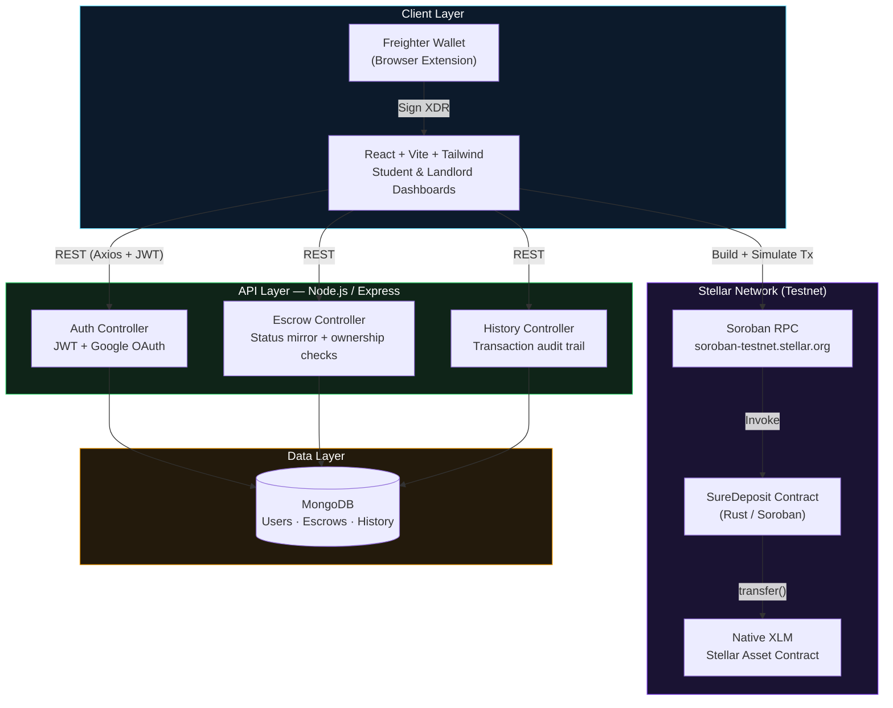
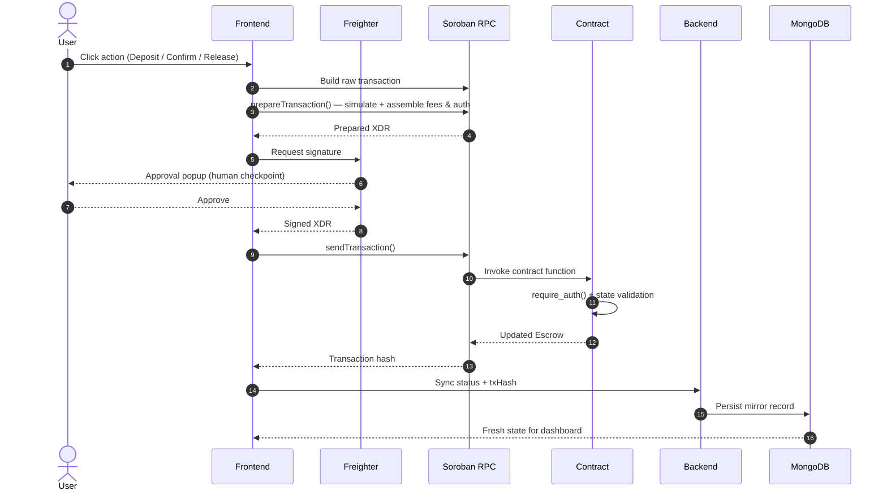
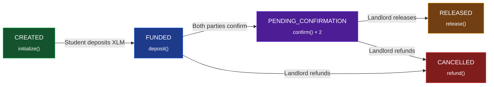
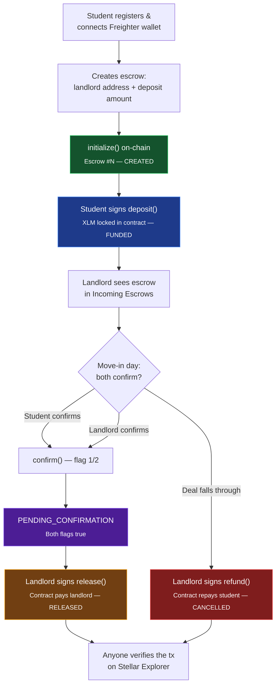
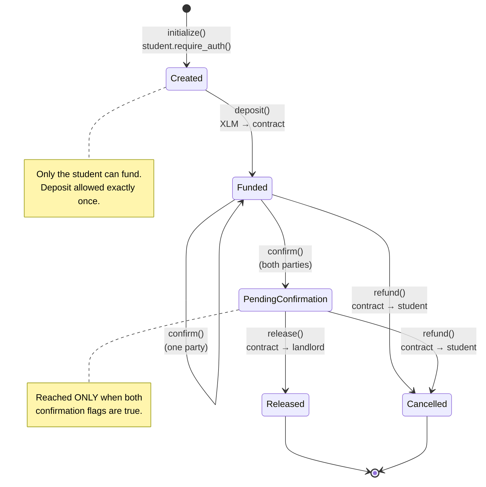
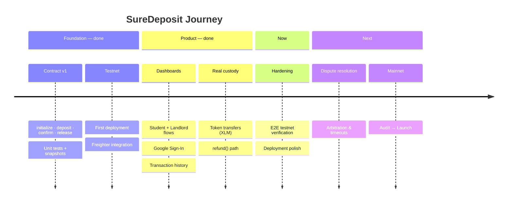

<!-- ══════════════════════════════════════════════════════════════════ -->
<!--                     ANIMATED HERO — CAPSULE RENDER                  -->
<!-- ══════════════════════════════════════════════════════════════════ -->

<div align="center">


<!-- Animated typing tagline -->

<a href="#">

</a>

<br/><br/>

*A decentralized escrow platform that locks rental security deposits inside Soroban smart contracts —*
*tenants never lose money, landlords never take risks, and no intermediary ever touches the funds.*

<br/>

<!-- ── Badge wall ─────────────────────────────────────────────── -->

[](https://github.com/omjoshi-2307/SureD/stargazers)
[](https://github.com/Khushal-93/SureD/network/members)
[](LICENSE)
[](#testing)

[](https://www.rust-lang.org/)
[](https://stellar.org)
[](https://soroban.stellar.org)
[](https://www.typescriptlang.org/)

[](https://react.dev)
[](https://nodejs.org)
[](https://www.mongodb.com)
[](#contributing)

<br/>

<!-- Product demo GIF -->


<br/><br/>

**[Live Demo](#)** &nbsp;·&nbsp; **[Documentation](#table-of-contents)** &nbsp;·&nbsp; **[Report Bug](https://github.com/omjoshi-2307/SureD/issues)** &nbsp;·&nbsp; **[Request Feature](https://github.com/omjoshi-2307/SureD/issues)**

</div>

<!-- Animated gradient divider -->


## Table of Contents

<details open>
<summary><b>Navigation</b></summary>
<br/>

| | | |
|---|---|---|
| [The Story](#the-story) | [Architecture](#architecture) | [Security](#security) |
| [Features](#features) | [Smart Contract](#smart-contract) | [Roadmap](#roadmap) |
| [Tech Stack](#tech-stack) | [Installation](#installation) | [Testing](#testing) |
| [Project Structure](#project-structure) | [Screenshots](#screenshots) | [Performance](#performance) |
| [Workflow](#workflow) | [Use Cases](#use-cases) | [Contributing](#contributing) |
| [License](#license) | [Authors](#authors) | [Acknowledgements](#acknowledgements) |

</details>


## The Story

<table>
<tr>
<td width="50%" valign="top">

### The Problem

Every year, millions of tenants — especially students moving to new cities — hand over one to three months of rent as a *security deposit* to a landlord they have never met.

Then the familiar pattern begins:

- Deposits vanish into personal bank accounts
- No receipts, no proof, no paper trail
- Refunds delayed for months — or forever
- Legal recourse costs more than the deposit itself
- Trust is enforced by hope, not by systems

> Roughly **40% of tenants** report disputes over deposit deductions. The most vulnerable — students and first-time renters — lose the most.

</td>
<td width="50%" valign="top">

### The Fix

**SureDeposit removes the middleman entirely.**

The deposit never touches the landlord's pocket. It lives inside a **Soroban smart contract on Stellar** — a neutral, incorruptible vault that follows one rule:

> *Funds move only when the rules written in code say they can.*

- Tenant deposits — funds lock **on-chain**
- Both parties confirm move-in
- Landlord releases — instant, verified payout
- Deal falls through — refund path back to tenant
- Every step — a public, immutable transaction

</td>
</tr>
</table>

### Why Blockchain, Why Stellar, Why Soroban

| Question | Answer |
|---|---|
| **Why blockchain at all?** | Escrow requires a neutral third party. Banks charge for it, lawyers are slow, and "trusted" middlemen are the exact problem. A smart contract is a third party that cannot be bribed, biased, or bankrupted. |
| **Why Stellar?** | Transactions settle in **~5 seconds** for **fractions of a cent**. A deposit platform for students cannot ask users to pay $5 in gas to protect a $300 deposit. Stellar makes micro-escrow economically viable. |
| **Why Soroban?** | Soroban brings **Rust-based smart contracts** to Stellar — memory-safe, formally testable, with a first-class authorization framework (`require_auth`). Financial logic deserves Rust's guarantees. |
| **Why escrow creates trust** | Neither party has to trust the *other* — only open-source code they can read, audit, and verify on a public explorer. Trust is replaced by verification. |


## Features

<div align="center">

| | | |
|:---:|:---:|:---:|
| **Secure Escrow**<br/><sub>Funds held by the contract itself — no human custody, ever</sub> | **Soroban Smart Contracts**<br/><sub>Rust-powered, tested state machine on Stellar</sub> | **Fully Decentralized**<br/><sub>Fund custody lives on-chain, verifiable by anyone</sub> |
| **Multi-Party Confirmation**<br/><sub>Both tenant and landlord must confirm move-in</sub> | **Instant Release**<br/><sub>Deposit settled in ~5 seconds once approved</sub> | **Immutable Records**<br/><sub>Every action is a permanent Stellar transaction</sub> |
| **Fraud Prevention**<br/><sub>No party can move funds unilaterally</sub> | **Freighter Wallet Integration**<br/><sub>One-click connect, sign, and verify</sub> | **Fast Transactions**<br/><sub>Stellar finality in seconds, not minutes</sub> |
| **Near-Zero Fees**<br/><sub>Fractions of a cent per operation</sub> | **Transparent Workflow**<br/><sub>Live status tracking from Created to Released</sub> | **Scalable Architecture**<br/><sub>Off-chain index (MongoDB) + on-chain truth</sub> |
| **Dispute Resolution** <sub>(roadmap)</sub><br/><sub>Structured refund and arbitration flows</sub> | **Rental Lifecycle Management**<br/><sub>Dashboards for every stage of the tenancy</sub> | **Transaction History**<br/><sub>Full audit trail for both roles</sub> |

</div>

> [!TIP]
> **The golden rule of SureDeposit:** the platform *never* holds user funds. The backend is only an index — the **smart contract is the single source of financial truth**.


## Architecture

### System Overview



### Transaction Lifecycle

Every on-chain action in SureDeposit follows the same pipeline:



### Escrow Lifecycle




## Workflow

The complete journey — from a nervous student to a verified, on-chain deposit release:



> [!TIP]
> Every step above produces a **transaction hash** shown in the UI. Paste it into [stellar.expert](https://stellar.expert/explorer/testnet) — the entire financial history of your escrow is publicly auditable, forever.


## Smart Contract

The core of SureDeposit is a compact, auditable Soroban contract written in **Rust** — a strict state machine where every transition is guarded by authentication and validation.

### Public Interface

| Function | Caller | Description |
|---|---|---|
| `initialize(student, landlord, amount)` | Student | Creates a new escrow record with a unique auto-incremented ID. Validates `amount > 0` and `student ≠ landlord`. |
| `deposit(escrow_id, caller)` | Student | Transfers the deposit **from the student into the contract's own address**. Only allowed once, only from `Created`. |
| `confirm(escrow_id, caller)` | Both parties | Each party independently confirms move-in. When both flags are set, status advances automatically. |
| `release(escrow_id, caller)` | Landlord | Pays the locked funds **from the contract to the landlord**. Only from `PendingConfirmation`. |
| `refund(escrow_id, caller)` | Landlord | Returns the locked funds **back to the student** if the deal falls through. |
| `get_escrow(escrow_id)` | Anyone | Public read — full escrow state, verifiable by any observer. |

### On-Chain Data Model

```rust
#[contracttype]
pub struct Escrow {
    pub escrow_id: u64,          // Auto-incremented unique ID
    pub student: Address,        // Tenant's Stellar address
    pub landlord: Address,       // Landlord's Stellar address
    pub amount: i128,            // Deposit in stroops (1 XLM = 10^7)
    pub status: EscrowStatus,    // The state machine
    pub student_confirmed: bool, // Move-in confirmation flags
    pub landlord_confirmed: bool,
}
```

### State Machine



<details>
<summary><b>Storage Design</b></summary>

<br/>

| Key | Storage Type | Holds |
|---|---|---|
| `DataKey::Escrow(u64)` | `persistent` | One `Escrow` struct per ID — long-lived financial state |
| `DataKey::NextEscrowId` | `persistent` | Monotonic counter guaranteeing unique IDs |
| `DataKey::Token` | `instance` | Address of the XLM Stellar Asset Contract, set once by the constructor |

The token address is set in `__constructor` at deploy time and **can never be changed afterwards** — eliminating any "swap the token" attack vector.

</details>

<details>
<summary><b>Events</b></summary>

<br/>

| Event | Emitted When | Payload |
|---|---|---|
| `escrow_created` | `initialize()` succeeds | `escrow_id, student, landlord, amount` |
| `escrow_funded` | `deposit()` succeeds | `escrow_id, student` |
| `escrow_released` | `release()` succeeds | `escrow_id, landlord, amount` |

Events make every escrow independently indexable by explorers and off-chain services — no trust in our backend required.

</details>

<details>
<summary><b>Error Codes</b></summary>

<br/>

| Error | Code | Trigger |
|---|---|---|
| `InvalidAmount` | 2 | Deposit amount ≤ 0 |
| `SameAddress` | 3 | Student and landlord are the same wallet |
| `EscrowNotFound` | 4 | Unknown escrow ID |
| `InvalidState` | 5 | Action attempted in wrong lifecycle stage |
| `AlreadyConfirmed` | 6 | Double-confirmation by the same party |
| `AlreadyReleased` | 7 | Release attempted twice |
| `Unauthorized` | 8 | Caller is not a party to this escrow |

</details>

### Security Model

> [!IMPORTANT]
> **Every mutating function enforces two independent gates:**
> 1. **Identity** — `caller.require_auth()` cryptographically proves the transaction was signed by the claimed address.
> 2. **Role** — explicit checks that the caller is the student (deposit) or the landlord (release/refund) recorded on this exact escrow.
>
> Combined with strict state-transition validation, no sequence of calls — by anyone — can move funds outside the designed lifecycle.


## Tech Stack

<div align="center">

<!-- Animated skill icons -->

<a href="#tech-stack">

</a>

<br/><br/>

| Layer | Technology | Why |
|---|---|---|
| **Frontend** | React 18 · TypeScript · Vite · Tailwind CSS 4 · React Router 7 · Lucide Icons | Fast DX, type safety, utility-first premium UI |
| **Backend** | Node.js · Express · JWT · Google OAuth | Lightweight status mirror + role-based auth |
| **Blockchain** | Stellar (Testnet) · Soroban · Rust · soroban-sdk 26 | 5-second finality, sub-cent fees, memory-safe contracts |
| **Wallet** | Freighter (browser extension) · `@stellar/stellar-sdk` v15 | Non-custodial signing, XDR build / simulate / submit |
| **Database** | MongoDB · Mongoose | Off-chain index for dashboards and history |
| **Testing** | `cargo test` · Soroban testutils · test snapshots | Deterministic contract-level verification |
| **Deployment** | Stellar CLI · Vite build · Express server | One-command contract deploys |

</div>

<details>
<summary><b>Key Libraries</b></summary>

<br/>

```
Frontend                          Backend                     Contracts
─────────────────────             ─────────────────           ──────────────────
@stellar/stellar-sdk   v15        express                     soroban-sdk    26
@stellar/freighter-api            mongoose                    (testutils for dev)
react-router-dom       v7         jsonwebtoken
tailwindcss            v4         google-auth-library
lucide-react                      cors · dotenv
axios
```

</details>


## Project Structure

```
SureD/
│
├── contracts/                          #  ON-CHAIN LAYER
│   └── suredeposit/
│       ├── Cargo.toml                  #  Workspace config (soroban-sdk 26)
│       └── contracts/suredeposit/
│           ├── Makefile
│           └── src/
│               ├── lib.rs              #  Contract entry points & constructor
│               ├── escrow.rs           #  Core logic: initialize / deposit / confirm / release / refund
│               ├── storage.rs          #  Persistent storage keys & helpers
│               ├── types.rs            #  Escrow struct + EscrowStatus enum
│               ├── events.rs           #  On-chain event emission
│               ├── errors.rs           #  Typed contract errors
│               └── test.rs             #  Unit tests (mock auths + test tokens)
│
├── backend/                            #  API LAYER (Node / Express)
│   ├── server.js                       #  App bootstrap + CORS + routes
│   ├── config/db.js                    #  MongoDB connection
│   ├── controllers/
│   │   ├── authController.js           #  Register / Login / Google Sign-In
│   │   ├── escrowController.js         #  Escrow CRUD + fund/confirm/release/cancel mirrors
│   │   ├── historyController.js        #  Transaction audit trail
│   │   └── userController.js           #  Profiles & wallet linking
│   ├── middleware/
│   │   ├── authMiddleware.js           #  JWT verification
│   │   └── roleMiddleware.js           #  student / landlord / admin gates
│   ├── models/                         #  Mongoose schemas: User · Escrow · TransactionHistory
│   ├── routes/                         #  REST route definitions
│   └── services/syncService.js         #  Chain ↔ DB reconciliation
│
├── frontend/                           #  CLIENT LAYER (React / Vite / TS)
│   ├── src/
│   │   ├── App.tsx                     #  Router: landing + role-protected dashboards
│   │   ├── api/axios.ts                #  Authenticated API client
│   │   ├── services/
│   │   │   ├── sorobanService.ts       #  Build → simulate → sign → submit pipeline
│   │   │   ├── walletService.ts        #  Freighter connection
│   │   │   ├── escrowService.ts        #  Backend escrow API
│   │   │   ├── authService.ts          #  Session management
│   │   │   └── historyService.ts       #  Transaction history API
│   │   ├── components/
│   │   │   ├── dashboard/
│   │   │   │   ├── student/            #  CreateEscrow · MyDeposits · EscrowDetails
│   │   │   │   ├── landlord/           #  IncomingEscrows · LandlordEscrowDetails
│   │   │   │   └── shared/             #  Profile · Settings · Transaction history
│   │   │   └── ui/                     #  Landing page: Hero · HowItWorks · Plans · Auth
│   │   ├── routes/ProtectedRoute.tsx   #  Role-based route guard
│   │   └── hooks/useAuth.ts            #  Auth state hook
│   └── vite.config.ts
│
└── package.json                        #  Monorepo scripts (dev:frontend / dev:backend)
```

> [!NOTE]
> **Three layers, one rule:** the frontend talks to the chain *directly* for anything involving money (via Freighter + Soroban RPC). The backend never signs, never holds keys, and never touches funds — it only mirrors state for fast dashboards.


## Installation

### Prerequisites

| Tool | Version | Install |
|---|---|---|
| Rust | stable | `curl --proto '=https' --tlsv1.2 -sSf https://sh.rustup.rs \| sh` |
| Stellar CLI | latest | `cargo install --locked stellar-cli` |
| Node.js | ≥ 18 | [nodejs.org](https://nodejs.org) |
| MongoDB | ≥ 6 | Local or [Atlas](https://www.mongodb.com/atlas) |
| Freighter | latest | [freighter.app](https://www.freighter.app/) browser extension |

### 1 — Clone & Install

```bash
git clone https://github.com/omjoshi-2307/SureD.git
cd suredeposit

# Frontend dependencies
cd frontend && npm install && cd ..

# Backend dependencies
cd backend && npm install && cd ..
```

### 2 — Build & Deploy the Smart Contract

```bash
cd contracts/suredeposit

# Add the WASM target & build
rustup target add wasm32v1-none
stellar contract build

# Run the test suite first — always
cargo test

# Create + fund a testnet identity (one time)
stellar keys generate deployer --network testnet --fund

# Get the native XLM token contract address on testnet
stellar contract id asset --asset native --network testnet

# Deploy — pass the token address to the constructor
stellar contract deploy \
  --wasm target/wasm32v1-none/release/suredeposit.wasm \
  --source deployer \
  --network testnet \
  -- \
  --token <NATIVE_XLM_SAC_ADDRESS>
```

> Copy the printed contract ID (`C...`) — you will need it in the next step.

### 3 — Environment Variables

<details open>
<summary><b><code>frontend/.env</code></b></summary>

```env
VITE_CONTRACT_ID=C...                                        # From step 2
VITE_SOROBAN_RPC=https://soroban-testnet.stellar.org
VITE_NETWORK_PASSPHRASE="Test SDF Network ; September 2015"
VITE_GOOGLE_CLIENT_ID=<your-google-oauth-client-id>
```

</details>

<details>
<summary><b><code>backend/.env</code></b></summary>

```env
PORT=5000
MONGO_URI=mongodb://localhost:27017/suredeposit
JWT_SECRET=<generate-a-long-random-string>
GOOGLE_CLIENT_ID=<same-as-frontend>
```

</details>

> [!WARNING]
> Never commit `.env` files. Both are already covered by `.gitignore` — keep it that way.

### 4 — Run Locally

```bash
# Terminal 1 — Backend API
cd backend && npm run dev        # → http://localhost:5000

# Terminal 2 — Frontend
cd frontend && npm run dev       # → http://localhost:5173
```

### 5 — Fund Test Wallets

Create **two** Freighter accounts (student + landlord) and fund each on testnet:

```
https://friendbot.stellar.org/?addr=G...YOUR_PUBLIC_KEY
```

**You're live.** Register as a student, connect Freighter, and create your first escrow.


## Screenshots

<div align="center">

<!-- Replace the GIF placeholders below with real screen recordings for maximum impact -->


<sub>Creating and funding an escrow — end to end</sub>

<br/><br/>

| Landing Page | Student Dashboard |
|:---:|:---:|
|  |  |

| Wallet Connect | Create Escrow |
|:---:|:---:|
|  |  |

| Deposit Signing | Move-In Confirmation |
|:---:|:---:|
|  |  |

| Deposit Release | On-Chain Verification |
|:---:|:---:|
|  |  |

<br/>


<sub>Fully responsive — the entire escrow lifecycle works from a phone.</sub>

</div>


## Security

<table>
<tr>
<td width="50%" valign="top">

### On-Chain Guarantees

- **Wallet signatures** — every mutating call requires `require_auth()`; the Stellar protocol itself verifies the cryptographic signature before the contract even runs.
- **Role authorization** — `deposit` only from the recorded student, `release`/`refund` only from the recorded landlord. Checked per-escrow, not globally.
- **State-machine enforcement** — no funding twice, no releasing twice, no release before dual confirmation. `InvalidState` blocks every shortcut.
- **Immutable custody** — funds sit at `env.current_contract_address()`. No admin key, no owner backdoor, no upgrade switch to drain them.
- **Replay protection** — Stellar sequence numbers make every signed transaction single-use; a captured XDR is worthless the moment it is submitted.
- **Fixed token binding** — the XLM token address is set once in the constructor and can never be re-pointed.

</td>
<td width="50%" valign="top">

### Off-Chain Guarantees

- **JWT authentication** — every API request carries a signed token; sessions are isolated per user.
- **Google OAuth** — optional single sign-on with server-side token verification.
- **Role middleware** — student / landlord / admin gates on every route.
- **Ownership checks** — the backend re-verifies that the requester's wallet is actually a party to the escrow before mirroring any state change.
- **On-chain verification** — the database is a convenience cache; the contract state is authoritative and can be re-read by anyone at any time via public RPC.
- **Zero custody** — the backend has no private keys. Even a full server compromise cannot move a single stroop.

</td>
</tr>
</table>

> [!IMPORTANT]
> **Threat model in one sentence:** compromise the frontend, compromise the backend, compromise the database — and the funds *still* cannot move, because only the student's and landlord's own wallet signatures satisfy the contract.


## Roadmap



### Completed

- [x] Soroban smart contract — full escrow state machine
- [x] Unit tests with mock auths and test snapshots
- [x] Stellar Testnet deployment
- [x] Freighter wallet integration (connect · sign · submit)
- [x] Escrow creation, deposit and dual-confirmation flow
- [x] On-chain release flow (end-to-end)
- [x] Student dashboard — create, track and manage deposits
- [x] Landlord dashboard — incoming escrows, confirm and release
- [x] JWT auth + Google Sign-In with role selection
- [x] Transaction history for both roles
- [x] Production CORS and deployment preparation

### In Progress

- [ ] Real XLM custody — token `transfer` inside `deposit` / `release`
- [ ] `refund()` — on-chain path returning funds to the student
- [ ] Chain ↔ DB consistency for cancellations

### Planned

- [ ] Real-time notifications (escrow events → email / push)
- [ ] Dispute resolution — arbitration with evidence and timeouts
- [ ] Auto-release deadlines (landlord inactivity protection)
- [ ] Property manager multi-unit dashboards
- [ ] Mobile app (React Native)
- [ ] USDC support for stable-value deposits
- [ ] Independent security audit
- [ ] **Stellar Mainnet launch**


## Testing

### Contract Unit Tests

The contract ships with deterministic Rust tests using Soroban's `testutils` — mock authorization, generated addresses, and a real test token:

```bash
cd contracts/suredeposit
cargo test
```

```
running 2 tests
test test::test_initialize_and_get_escrow ... ok
test test::test_multiple_escrows ... ok

test result: ok. 2 passed; 0 failed
```

| Layer | Method | What It Proves |
|---|---|---|
| **Unit** | `cargo test` + `mock_all_auths` | State machine correctness, error paths, ID uniqueness |
| **Snapshots** | `test_snapshots/` JSON | Storage layout is stable across changes |
| **Deployment** | `stellar contract invoke` on testnet | Real network behavior — auth, fees, footprints |
| **Manual E2E** | Two Freighter wallets | Full lifecycle: create → fund → confirm ×2 → release / refund |
| **Explorer** | [stellar.expert](https://stellar.expert/explorer/testnet) | Independent, third-party verification of every balance change |

> [!TIP]
> **The ultimate test** is one no mock can fake: watch the student's XLM balance drop on deposit and the landlord's rise on release — on a public block explorer neither party controls.


## Performance

<div align="center">

### Why Stellar Is the Right Chain for Deposits

| Metric | Stellar | Typical L1 | Why It Matters Here |
|---|:---:|:---:|---|
| **Finality** | ~5 seconds | 1–15 minutes | A tenant standing at the door gets confirmation immediately |
| **Tx Fee** | ~0.00001 XLM (< $0.01) | $0.50 – $50 | Fees cannot eat into a student's deposit |
| **Consensus** | Stellar Consensus Protocol | PoW / PoS | Energy-efficient, no mining, deterministic finality |
| **Contract Safety** | Rust + Soroban host | Solidity / EVM | Memory safety + first-class auth framework |
| **Throughput** | 1000s TPS capacity | Varies | Scales to entire rental markets, not just demos |

</div>

> *A $300 student deposit protected for less than a cent, settled before the landlord finishes shaking your hand. That is why Stellar.*


## Use Cases

<div align="center">

| Who | How SureDeposit Helps |
|---|---|
| **Students** | Move to a new city without fearing the deposit will vanish — funds are provably locked, provably refundable |
| **Landlords** | Verified proof of funds before handing over keys; zero handling of other people's money; on-chain reputation |
| **Property Managers** | Manage dozens of escrows from one dashboard with a complete audit trail per unit |
| **Rental Companies** | Replace deposit-holding bank accounts, compliance overhead, and manual refunds with programmable escrow |
| **Hostels & PGs** | High-turnover, small-deposit environments where fee-heavy escrow was never viable — until sub-cent transactions |
| **Universities** | Offer students an official, neutral deposit rail for accommodation partners |
| **Cross-Border Renters** | International students pay deposits without wire fees, currency friction, or trusting a stranger overseas |

</div>


## Contributing

Contributions are welcome — from typo fixes to new contract features, every PR makes rental markets fairer.

### Quick Start

```bash
# 1. Fork the repository
# 2. Clone your fork
git clone https://github.com/<your-username>/suredeposit.git

# 3. Create a feature branch
git checkout -b feat/amazing-feature

# 4. Make your changes + run tests
cargo test            # contracts
npm run dev           # frontend / backend smoke test

# 5. Commit using Conventional Commits
git commit -m "feat(contract): add auto-release deadline"

# 6. Push & open a Pull Request
```

### Standards

<details>
<summary><b>Commit Convention</b></summary>

<br/>

We follow [Conventional Commits](https://www.conventionalcommits.org/):

| Prefix | Use For |
|---|---|
| `feat:` | New features |
| `fix:` | Bug fixes |
| `docs:` | Documentation only |
| `refactor:` | Code change with no behavior change |
| `test:` | Adding or fixing tests |
| `chore:` | Tooling, deps, CI |

Scopes: `contract`, `frontend`, `backend`, `docs` — e.g. `feat(contract): ...`

</details>

<details>
<summary><b>Pull Request Guidelines</b></summary>

<br/>

- One focused change per PR
- `cargo test` passes for any contract change
- No `.env` files, secrets, or private keys — ever
- Screenshots / GIFs for UI changes
- Contract changes must include updated tests **and** a note on state-machine impact
- Describe *why*, not just *what*

</details>

<details>
<summary><b>Reporting Issues</b></summary>

<br/>

**Bug reports** — include: steps to reproduce, expected vs. actual behavior, network (testnet / local), browser + Freighter version, and the transaction hash if on-chain.

**Feature requests** — include: the problem it solves, who benefits (student / landlord / both), and whether it touches the contract state machine.

**Security issues** — please **do not** open a public issue. Email the maintainers directly.

</details>


## License

<div align="center">

Released under the **MIT License**.

```
MIT License

Copyright (c) 2026 SureDeposit Contributors

Permission is hereby granted, free of charge, to any person obtaining a copy
of this software and associated documentation files (the "Software"), to deal
in the Software without restriction, including without limitation the rights
to use, copy, modify, merge, publish, distribute, sublicense, and/or sell
copies of the Software...
```

See [LICENSE](LICENSE) for the full text.

**Free to use. Free to fork. Free to build a fairer rental market.**

</div>


## Authors

The contributors below are identified from the commit history of the original `Khushal-93/SureD:main` branch. Roles summarize the work visible in their commits.

<div align="center">

<table>
<tr>
<td align="center" width="250">
<a href="https://github.com/Khushal-93">

</a>
<br/>
<b><a href="https://github.com/Khushal-93">Khushal Choudhary</a></b>
<br/>
<sub>Project Creator & Lead Developer</sub>
<br/>
<sub>Core Product · Soroban Smart Contracts · Full-Stack Development · Deployment</sub>
</td>
<td align="center" width="250">
<a href="https://github.com/omjoshi-2307">

</a>
<br/>
<b><a href="https://github.com/omjoshi-2307">Om Joshi</a></b>
<br/>
<sub>Full-Stack Contributor</sub>
<br/>
<sub>Frontend UI · Legal Pages · Documentation · Escrow, Auth & History Stabilization</sub>
</td>
</tr>
<tr>
<td align="center" width="250">
<a href="https://github.com/Tushar15769">

</a>
<br/>
<b><a href="https://github.com/Tushar15769">Tushar15769</a></b>
<br/>
<sub>Backend & Integration Contributor</sub>
<br/>
<sub>Backend Foundation · Authentication · Wallet Integration · Escrow Workflow · Transaction History</sub>
</td>
<td align="center" width="250">
<a href="https://github.com/pushkarshinde007">

</a>
<br/>
<b><a href="https://github.com/pushkarshinde007">pushkarshinde007</a></b>
<br/>
<sub>Developer Experience Contributor</sub>
<br/>
<sub>Project Scripts · Unified Development Workflow · Favicon</sub>
</td>
</tr>
</table>

<br/>

<!-- Star history for this repository -->

<a href="https://star-history.com/#omjoshi-2307/SureD&Date">

</a>

</div>

## Acknowledgements

<div align="center">

*Standing on the shoulders of giants.*

<table>
<tr>
<td align="center" width="50%">

**[Stellar Development Foundation](https://stellar.org)**

for a blockchain that makes financial fairness affordable

</td>
<td align="center" width="50%">

**[Soroban](https://soroban.stellar.org)**

for bringing Rust-grade safety to smart contracts

</td>
</tr>
<tr>
<td align="center" width="50%">

**[Freighter](https://www.freighter.app/)**

for frictionless, non-custodial signing

</td>
<td align="center" width="50%">

**[The Rust Community](https://www.rust-lang.org/community)**

for a language where financial bugs go to die

</td>
</tr>
<tr>
<td align="center" width="50%">

**[React](https://react.dev)** · **[Vite](https://vitejs.dev)** · **[Tailwind CSS](https://tailwindcss.com)**

for making beautiful UIs fast to build

</td>
<td align="center" width="50%">

**The Open Source Community**

for every library, answer, and example that made this possible

</td>
</tr>
<tr>
<td colspan="2" align="center">

**Hackathon organizers & mentors**

for the deadline that turned an idea into a product

</td>
</tr>
</table>

</div>
<!-- ══════════════════════════════════════════════════════════════════ -->
<!--                              FOOTER                                 -->
<!-- ══════════════════════════════════════════════════════════════════ -->

<div align="center">

<br/>

### SureDeposit

**Made with care · Built on Stellar · Powered by Soroban**

<br/>

[](https://github.com/omjoshi-2307/SureD)
[](#)
[](#)
[](#)

<br/>

**If SureDeposit made you rethink how deposits should work — star the repo.**

<br/>

<sub>© 2026 SureDeposit Contributors · Released under the MIT License</sub>

<!-- Animated wave footer -->


</div>
