# SureD — Product Vision & Upcoming Evolution

> **Where every transaction begins with certainty.**  
> SureD is a rental security-deposit escrow concept built to make deposit handling more transparent, verifiable, and fair for tenants and landlords.

This document explains the product journey from **SureD V1** to the proposed **SureD V2**. It is a product and architecture vision document, not a claim that every V2 feature is already implemented.

---

## Table of Contents

- [1. The Problem](#1-the-problem)
- [2. The Core Idea](#2-the-core-idea)
- [3. SureD V1 — The Foundation](#3-sured-v1--the-foundation)
- [4. SureD V1 — Transaction Flow](#4-sured-v1--transaction-flow)
- [5. Why V1 Needs to Evolve](#5-why-v1-needs-to-evolve)
- [6. SureD V2 — Shared Rental Escrow](#6-sured-v2--shared-rental-escrow)
- [7. SureD V2 — Proposed User Journey](#7-sured-v2--proposed-user-journey)
- [8. V1 vs V2](#8-v1-vs-v2)
- [9. Proposed V2 Architecture](#9-proposed-v2-architecture)
- [10. Important V2 Capabilities](#10-important-v2-capabilities)
- [11. Design Principles & Open Decisions](#11-design-principles--open-decisions)
- [12. Product Roadmap](#12-product-roadmap)

---

## 1. The Problem

A rental security deposit is usually paid before a tenant moves into a property. In a traditional arrangement, the landlord holds the deposit and the tenant relies on an agreement and mutual trust for its eventual return.

This can create problems:

- Tenants may not have a clear, shared record of the amount paid.
- Refunds can be delayed or become difficult to verify.
- Disagreements can arise over deductions, property condition, or responsibilities.
- Students and people sharing accommodation may contribute different amounts, making the final settlement harder to track.
- In shared rentals, one person may end up coordinating the entire deposit even when several people contributed.

The underlying issue is not simply payment. It is the lack of a transparent, structured process for **holding, tracking, confirming, and settling a security deposit**.

## 2. The Core Idea

**SureD is a blockchain-powered rental security-deposit escrow platform.**

Instead of treating the deposit as an informal payment between two people, SureD uses a Soroban smart contract on the Stellar network to provide a rule-governed escrow process.

The intended principle is:

> The deposit should be handled according to an agreed process, with a verifiable record of who contributed, who confirmed, and how the funds were settled.

### The idea at a glance

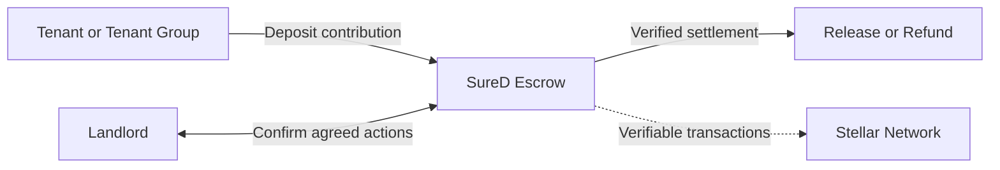

SureD has two stages of product evolution:

- **V1 — Individual Rental Escrow:** one tenant, one landlord, and one escrow record.
- **V2 — Shared Rental Escrow:** multiple co-tenants contribute to one rental agreement, with individual contribution tracking and a structured settlement process.

---

## 3. SureD V1 — The Foundation

Existing product foundation

SureD V1 establishes the basic escrow workflow for a rental security deposit between one tenant and one landlord.

### Participants

| Participant | Responsibility |
|---|---|
| Tenant | Creates the escrow and deposits the agreed amount. |
| Landlord | Confirms the agreed rental step and participates in settlement. |
| Soroban smart contract | Holds and moves funds according to its programmed rules. |
| SureD application | Provides the interface, account experience, and transaction history. |

### V1 concept

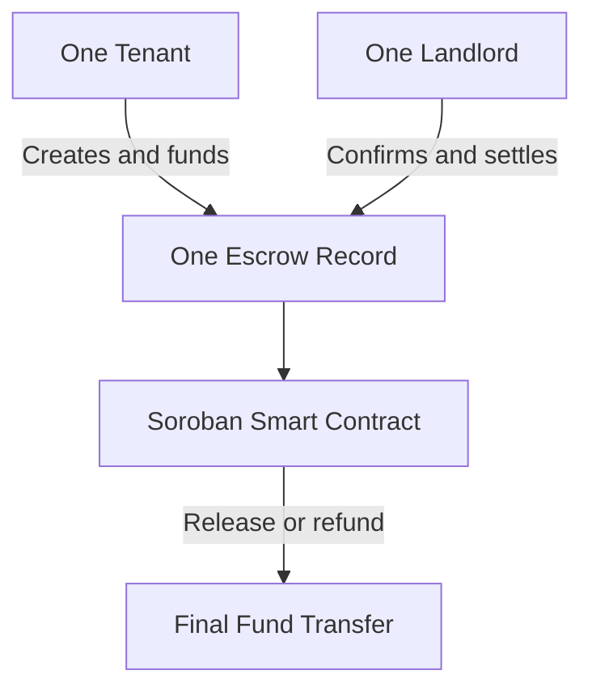

### Main V1 workflow

1. The tenant creates an escrow with the landlord and the agreed deposit amount.
2. The tenant funds the escrow through the supported Stellar transaction flow.
3. The tenant and landlord provide their required confirmations.
4. The landlord performs the contract-authorized release when the release conditions are met.
5. If the rental arrangement is cancelled under the supported refund path, the contract can return the funds to the tenant.

### V1 escrow lifecycle

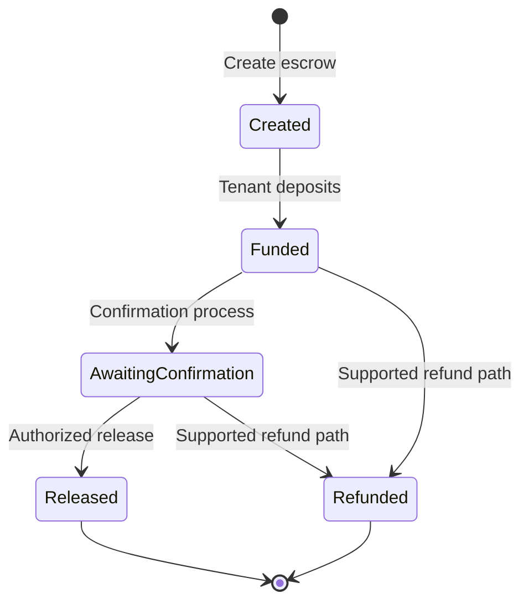

### V1 technology foundation

| Layer | Technology / responsibility |
|---|---|
| Frontend | React, TypeScript, Vite, and Tailwind CSS |
| Backend | Node.js and Express APIs |
| Data layer | MongoDB / Mongoose for application records |
| Blockchain | Stellar network |
| Smart contracts | Rust with Soroban |
| Wallet | Freighter for transaction signing |

**Important:** the smart contract is intended to govern on-chain fund custody and contract transitions. The backend database is an application record/index; it should not be treated as independent proof that an on-chain transaction succeeded.

---

## 4. SureD V1 — Transaction Flow

The following diagram shows the high-level interaction between the user interface, wallet, Stellar network, smart contract, and application backend.

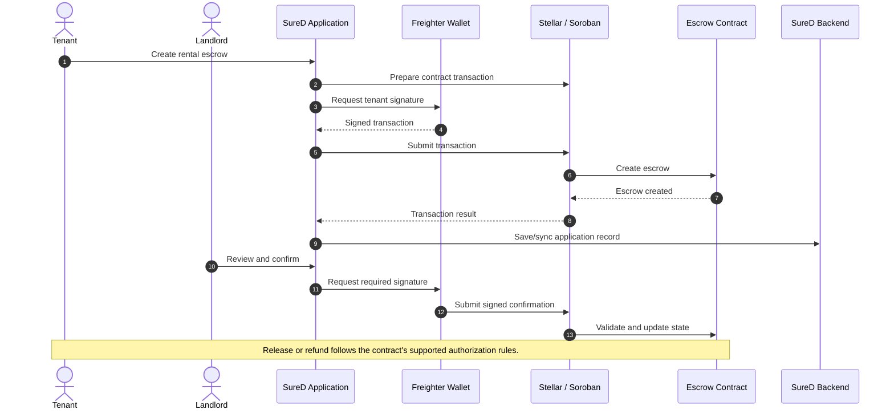

This is a conceptual interaction diagram. Exact transaction calls and state transitions must always be checked against the deployed contract version.

---

## 5. Why V1 Needs to Evolve

V1 solves the basic two-party escrow problem, but shared accommodation introduces a more complex situation.

Consider three students renting one apartment:

- The total security deposit is ₹30,000.
- Tenant A contributes ₹12,000.
- Tenant B contributes ₹10,000.
- Tenant C contributes ₹8,000.

If the application records only one tenant and one total escrow amount, it does not naturally explain each person's contribution or how a final refund should be distributed.

The group needs answers to questions such as:

- Who has joined this rental agreement?
- How much has each person contributed?
- Has the full deposit been funded?
- Who has confirmed the rental details?
- How should the refundable balance be distributed?
- How should an agreed deduction be represented and approved?

**This is the gap SureD V2 aims to address.**

---

## 6. SureD V2 — Shared Rental Escrow

Proposed product direction — not yet implemented

SureD V2 evolves the product from a simple two-party escrow into a **shared, multi-tenant rental deposit management system**.

Multiple co-tenants can join one rental group, contribute their individual shares, and view a common escrow record while retaining a clear record of their own contributions.

### V2 concept

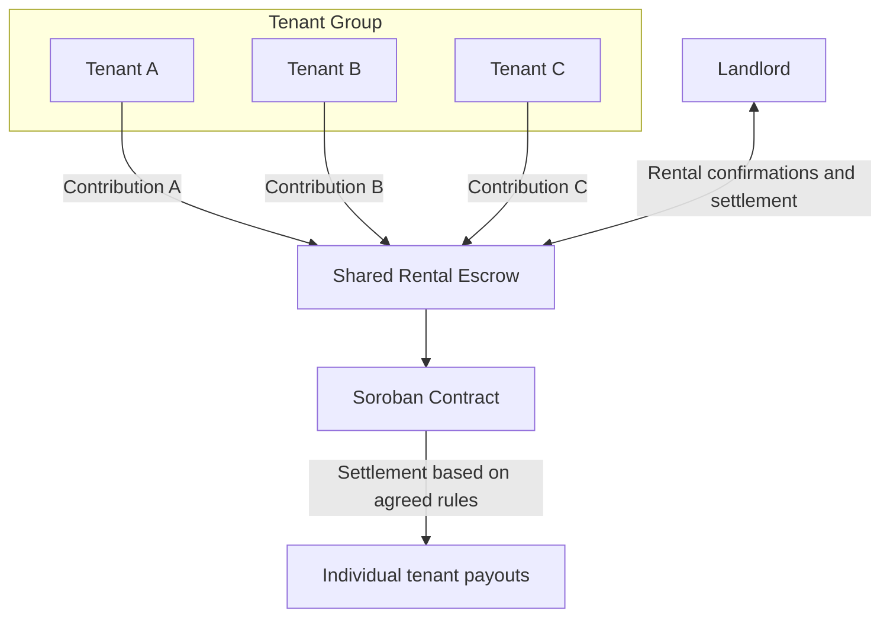

### What changes in V2?

| Area | V1 | V2 — Proposed |
|---|---|---|
| Tenants | One tenant | Multiple co-tenants |
| Escrow | One tenant-landlord record | One shared rental escrow |
| Contributions | One tenant funds the deposit | Each tenant contributes their share |
| Tracking | Overall escrow amount and status | Overall status plus per-tenant contribution records |
| Joining | Individual rental flow | Invite and join a rental group |
| Confirmation | Tenant and landlord | Multi-tenant and landlord confirmation rules to be defined |
| Settlement | Single tenant refund/release path | Proposed contribution-aware distribution |
| Visibility | Individual escrow view | Shared group view with individual records |

---

## 7. SureD V2 — Proposed User Journey

### Step-by-step flow

1. **Create a rental group:** a tenant starts a shared rental agreement and enters the property and landlord details.
2. **Invite co-tenants:** other tenants receive an invitation and join the group.
3. **Set contribution shares:** the group records each tenant's agreed deposit contribution.
4. **Fund the shared escrow:** each tenant completes their own contribution transaction.
5. **Verify funding:** the application displays each contribution and whether the required total has been reached.
6. **Confirm the rental agreement:** the required participants confirm the shared rental details.
7. **Track the tenancy:** members can view the escrow status and relevant history.
8. **Settle the deposit:** at the end of the tenancy, the agreed release or refund process is initiated.
9. **Distribute the outcome:** the proposed V2 settlement logic uses the recorded contribution ledger and approved settlement terms to calculate each tenant's share.

### V2 end-to-end flow

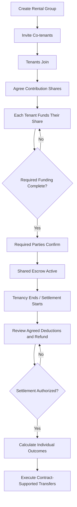

### Example: shared deposit contributions

Illustrative example only — not a finalized settlement policy.

<box>
  <text color="secondary" weight="medium" size="sm">Total agreed security deposit</text>
  <title size="2xl" color="default" tabularNums>₹30,000</title>
  <divider color="subtle"/>
  | Tenant | Contribution | Share |
  |---|---:|---:|
  | Tenant A | ₹12,000 | 40% |
  | Tenant B | ₹10,000 | 33.33% |
  | Tenant C | ₹8,000 | 26.67% |
  | **Total** | **₹30,000** | **100%** |
</box>

This ledger makes the original contributions visible. The exact refund formula, treatment of deductions, and approval rules must be agreed and specified before implementation; contribution percentages alone do not resolve every real-world dispute.

### Proposed contribution ledger

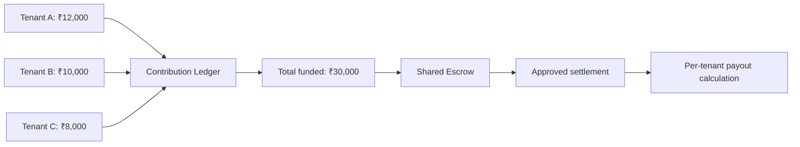

---

## 8. V1 vs V2

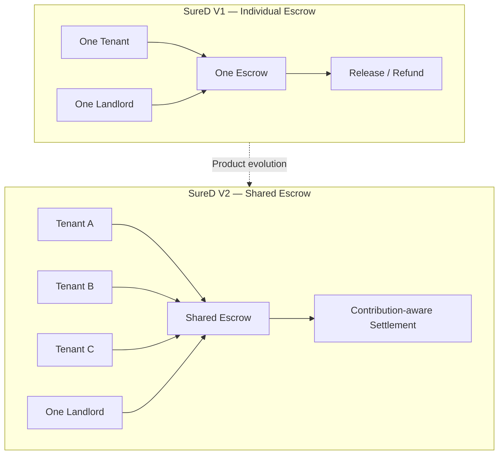

**In one sentence:**

- V1 protects a security deposit between one tenant and one landlord.
- V2 aims to manage one shared security deposit contributed by multiple tenants, while tracking each person's contribution and proposed settlement.

---

## 9. Proposed V2 Architecture

The following is a target architecture concept. It does not assert that the current V1 backend or smart contract already supports group escrow.

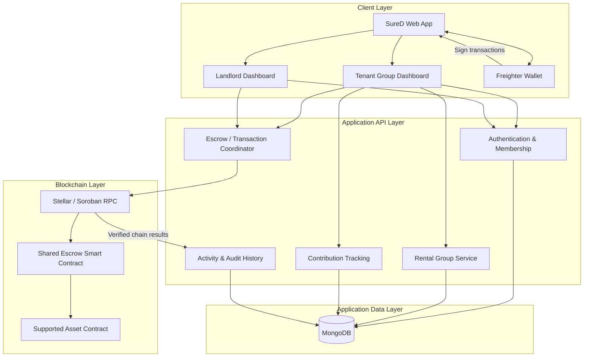

### Proposed V2 data model

| Entity | Purpose |
|---|---|
| User | Tenant or landlord account |
| RentalGroup | Shared rental arrangement and membership |
| GroupMember | User's role, membership state, and participation |
| Contribution | Tenant, amount, asset, transaction reference, and funding status |
| SharedEscrow | Contract reference, total target, funded amount, and on-chain status |
| Confirmation | Who confirmed which agreed step and when |
| Settlement | Approved settlement terms and calculated outcomes |
| Activity | Human-readable history linked to verifiable transaction references |

The contract and database responsibilities must be designed carefully. The database can organize group membership and display records, but the chain must remain authoritative for on-chain custody and contract-enforced transfers.

---

## 10. Important V2 Capabilities

### 1. Rental group creation
A tenant can create a shared rental space and define the basic agreement details.

### 2. Invite and join
Co-tenants can be invited to the group. Membership should be authenticated and tied to the correct rental agreement.

### 3. Individual contribution tracking
Every contribution should be attributable to a tenant and linked to a verifiable transaction reference.

### 4. Shared escrow visibility
All authorized group members can see the common funding progress and escrow status, while retaining their individual contribution history.

### 5. Multi-party confirmations
The product should support explicit confirmation rules. Which actions require every tenant, a tenant majority, or the landlord remains a product and security decision.

### 6. Transparent settlement
The application should show the proposed refund, any agreed deductions, and the calculation for each tenant before execution.

### 7. Individual refund distribution
The contract design should support a safe, deterministic way to distribute the approved outcome to the correct contributors. The exact policy must account for deductions, changed membership, partial funding, and disputes.

### 8. Complete activity history
Group creation, invitations, joins, contributions, confirmations, and settlement actions should be visible in an understandable timeline.

---

## 11. Design Principles & Open Decisions

V2 should be built around these principles:

- **Contribution transparency:** every tenant can understand how much they contributed.
- **Explicit authorization:** only the appropriate participants can perform or approve sensitive actions.
- **Verifiable transactions:** on-chain actions should be checked against Stellar, not trusted solely because an API request says they succeeded.
- **Privacy by design:** group members should see only the information they are authorized to access.
- **Failure-aware workflows:** partial funding, failed transactions, a tenant leaving the group, and disputed deductions need defined handling.
- **Incremental implementation:** evolve the existing product in small, testable steps rather than rewriting every layer at once.

### Decisions required before V2 implementation

1. Can a group be funded partially, and what happens if the funding deadline is missed?
2. Can a tenant leave or be replaced after contributing?
3. Does every tenant need to confirm move-in and settlement, or is another approval rule appropriate?
4. How are deductions proposed, evidenced, disputed, and approved?
5. Are refunds strictly proportional to original contributions, or can the signed agreement define another formula?
6. What happens if a participant becomes unreachable?
7. Which group and contribution rules belong on-chain, and which belong in the application database?

These are important product, legal, and smart-contract decisions. They should be settled before finalizing the V2 contract interface.

---

## 12. Product Roadmap

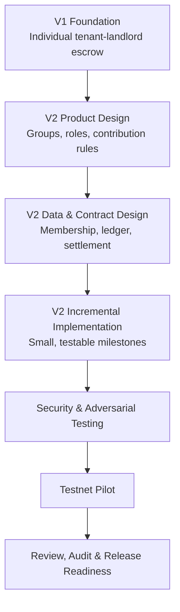

| Stage | Focus | Status |
|---|---|---|
| V1 | Individual tenant-landlord escrow foundation | Existing project foundation |
| V2 planning | Shared rental groups and contribution-aware escrow | Upcoming / proposed |
| V2 design | Data model, permissions, state machine, settlement policy | To be finalized |
| V2 implementation | Frontend, backend, and contract changes | Not started |
| Validation | Integration, security, and testnet testing | Future stage |

---

## Final Vision

SureD starts by making a single rental security deposit more transparent. Its next evolution is to make shared rentals easier to manage by giving every co-tenant a clear record and a fair, agreed process for their contribution and settlement.

> **SureD V1:** One tenant. One landlord. One escrow.  
> **SureD V2:** Multiple tenants. Shared escrow. Individual contribution tracking. Transparent settlement.

**Long-term direction:** build a reliable trust layer for rental security deposits — starting with individual rentals and evolving toward shared rental arrangements.

---

Documentation note: This file describes the current V1 concept and a proposed V2 direction. V2 capabilities, diagrams, data entities, and workflows are planning material until implemented, tested, and verified in the repository.

---

# Tenant Exit & Replacement Management

## Why this feature matters

Shared rentals are dynamic. A tenant may need to leave before the rental period ends because of a college transfer, internship, job relocation, financial changes, family circumstances, or disagreements within the household.

A shared-deposit system must handle these situations without making the remaining tenants' financial responsibilities unpredictable.

SureD V2 should therefore support a **Flexible Exit Model with Replacement Priority**:

- Finding an approved replacement is the preferred route.
- If no replacement is available, the departing tenant can still enter an agreed settlement process.
- Neither a refund nor a transfer of financial responsibility happens automatically.

This is a proposed V2 capability, not an implemented feature.

## Recommended policy: Flexible Exit with Replacement Priority

| Situation | SureD's intended handling |
|---|---|
| A suitable replacement is found | Start the replacement approval and onboarding process. |
| No replacement is available | Start an agreed exit-settlement process. |
| Landlord does not approve the replacement | Do not silently add the new tenant; use the applicable settlement process. |
| Remaining tenants cannot agree | Keep the exit request pending or disputed; do not force a financial change. |
| Departing tenant has outstanding obligations | Record them for review under the rental agreement and agreed terms. |

Replacement-first alone is too restrictive: real-life circumstances do not always allow a departing tenant to find a replacement quickly. Flexible exit provides a fallback while replacement priority helps preserve the shared rental arrangement.

## Tenant exit workflow

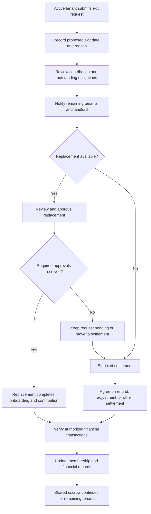

## Scenario A: Replacement tenant joins

Example shared deposit:

| Tenant | Original contribution |
|---|---:|
| Tenant A | ₹12,000 |
| Tenant B | ₹10,000 |
| Tenant C (leaving) | ₹8,000 |
| **Total** | **₹30,000** |

If Tenant C leaves and Tenant D is approved as the replacement:

1. Tenant C submits an exit request.
2. The remaining tenants and landlord review the proposed replacement, according to the rental agreement and platform rules.
3. Tenant D completes onboarding and the required contribution.
4. The platform records Tenant C's exit and Tenant D's new contribution as separate events.
5. Any amount payable to Tenant C is settled only through the agreed and authorized process.
6. The shared escrow continues with the updated membership.

**Important:** Tenant D's contribution must not automatically be treated as a refund to Tenant C. The incoming contribution, outgoing settlement, and escrow balance must be accounted for explicitly.

## Scenario B: No replacement is available

If Tenant C cannot find a replacement, the group may consider an agreed settlement.

For illustration, Tenant A and Tenant B might voluntarily agree to take on the vacant share:

| Tenant | Original contribution | Illustrative revised share |
|---|---:|---:|
| Tenant A | ₹12,000 | ₹15,000 |
| Tenant B | ₹10,000 | ₹15,000 |
| Tenant C (leaving) | ₹8,000 | Settled separately |
| **Continuing share total** | | **₹30,000** |

This is only an example of a possible agreement. It must not happen automatically. The remaining tenants must not be forced to absorb another tenant's share, and any settlement must follow the rental agreement, applicable requirements, and required approvals.

## Scenario C: Tenant leaves without an agreed exit

If a tenant leaves without completing the agreed process:

- The exit can remain pending or be marked as disputed.
- SureD should preserve the original contribution and transaction history.
- The platform should show unresolved obligations and notify the relevant parties.
- It must not automatically release funds or transfer the departing tenant's share to others.

Actual financial or legal responsibility depends on the rental agreement and applicable law. SureD records authorized decisions; it does not independently decide who is legally liable.

## Proposed exit states

The following are suggested application-level states. They are not existing V1 smart-contract states.

| State | Meaning |
|---|---|
| `ACTIVE` | Tenant is an active member of the rental group. |
| `EXIT_REQUESTED` | Tenant has submitted an exit request. |
| `UNDER_REVIEW` | Contributions, obligations, and approvals are being reviewed. |
| `REPLACEMENT_PENDING` | A proposed replacement is awaiting approval or funding. |
| `SETTLEMENT_PENDING` | The parties are working through an agreed settlement. |
| `EXITED` | The authorized exit and settlement process is complete. |
| `DISPUTED` | The request or financial terms are contested. |
| `REJECTED` | The request was rejected with a recorded reason. |

Membership status and financial status should be tracked separately. A tenant leaving the group must not erase or rewrite their contribution history.

## Core product rules and safeguards

1. **No automatic refund:** Submitting an exit request does not itself authorize a refund.
2. **No forced burden transfer:** Remaining tenants do not automatically inherit the departing tenant's financial share.
3. **Explicit approvals:** Replacement, membership changes, and settlements require the approvals defined by the rental agreement and SureD's agreed rules.
4. **Immutable history:** Preserve the departing tenant's original contribution and record all later transactions separately.
5. **Verified transactions:** Do not mark a contribution, refund, or settlement as complete merely because a client submits a transaction hash. Verify the relevant on-chain transaction and resulting state.
6. **Dispute handling:** If required parties disagree, preserve the funds and records according to the contract's dispute and timeout rules; do not invent an automatic outcome.
7. **Clear accounting:** Distinguish security-deposit contributions from rent, damages, fees, and other obligations. Any deduction or adjustment must have an agreed and valid basis.

## Proposed V2 module architecture

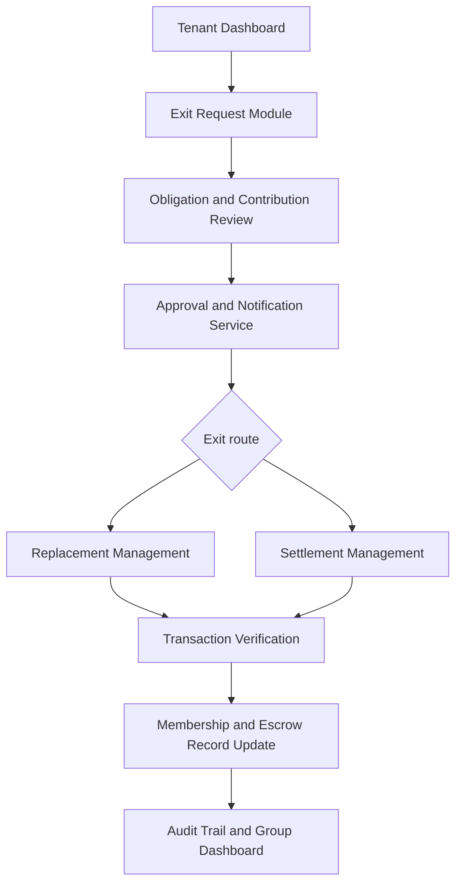

### Suggested data records

- **ExitRequest:** request ID, rental group, tenant ID, proposed exit date, reason category, current status, timestamps.
- **ReplacementProposal:** proposed tenant, approval status, required contribution, funding status.
- **ExitSettlement:** agreed amount, adjustments, parties' approvals, transaction references, settlement status.
- **MembershipHistory:** join/exit events, effective dates, actor and approval references.
- **TransactionHistory:** original contributions and every subsequent verified deposit, refund, or settlement event.

These are conceptual records. The final schema and contract interfaces require a separate technical design.

## Open decisions before implementation

- Which parties must approve a replacement or exit settlement?
- Does the landlord need to approve every replacement?
- What is the deadline for finding and funding a replacement?
- What happens if the replacement is approved but does not fund?
- How are partial contributions, unpaid rent, or disputed deductions handled?
- Which settlement routes are supported by the smart contract?
- What happens when the group cannot reach agreement?

These rules must be agreed before implementation. The existing V1 two-party escrow contract should not be assumed to support multi-tenant exits or payouts without a contract-level review and likely extension.

## Product decision

**SureD V2 direction: Flexible Exit Model with Replacement Priority.**

This balances continuity for the rental group with flexibility for people whose circumstances change. Replacement is the preferred path; an agreed settlement is the fallback. In both cases, transparent records, explicit authorization, and verified transactions protect the group.

